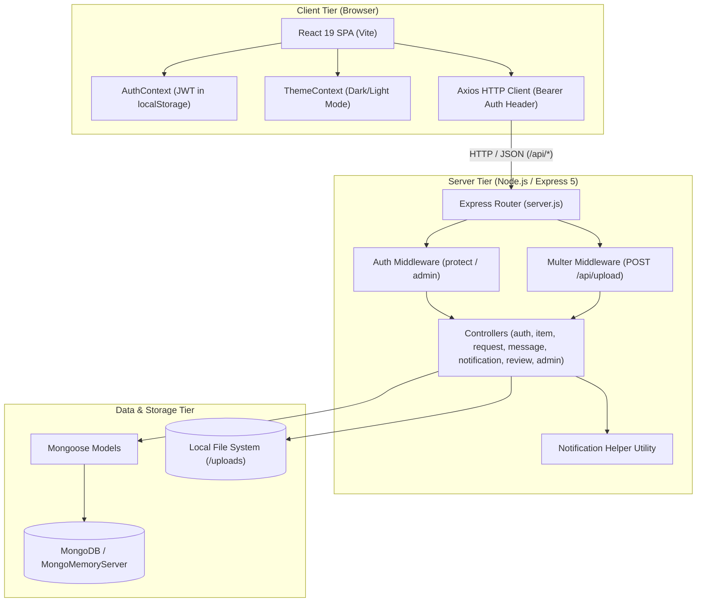
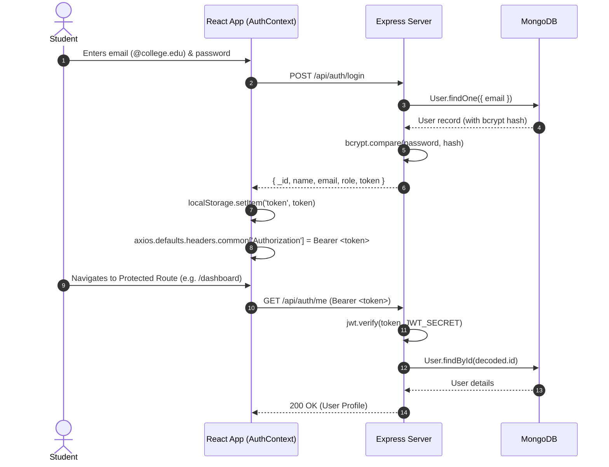
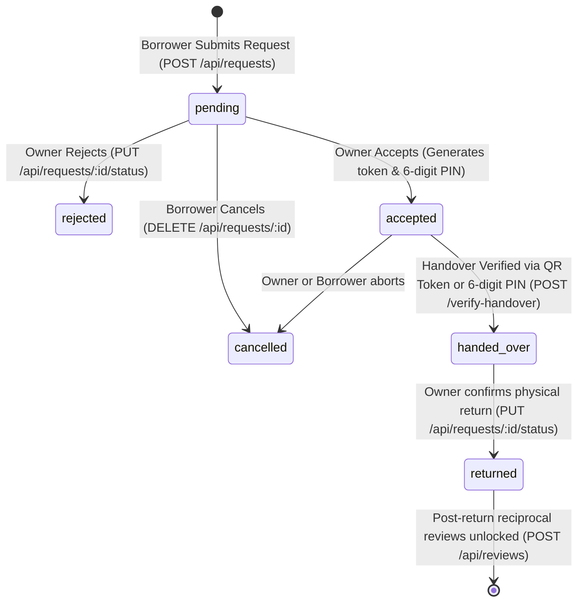
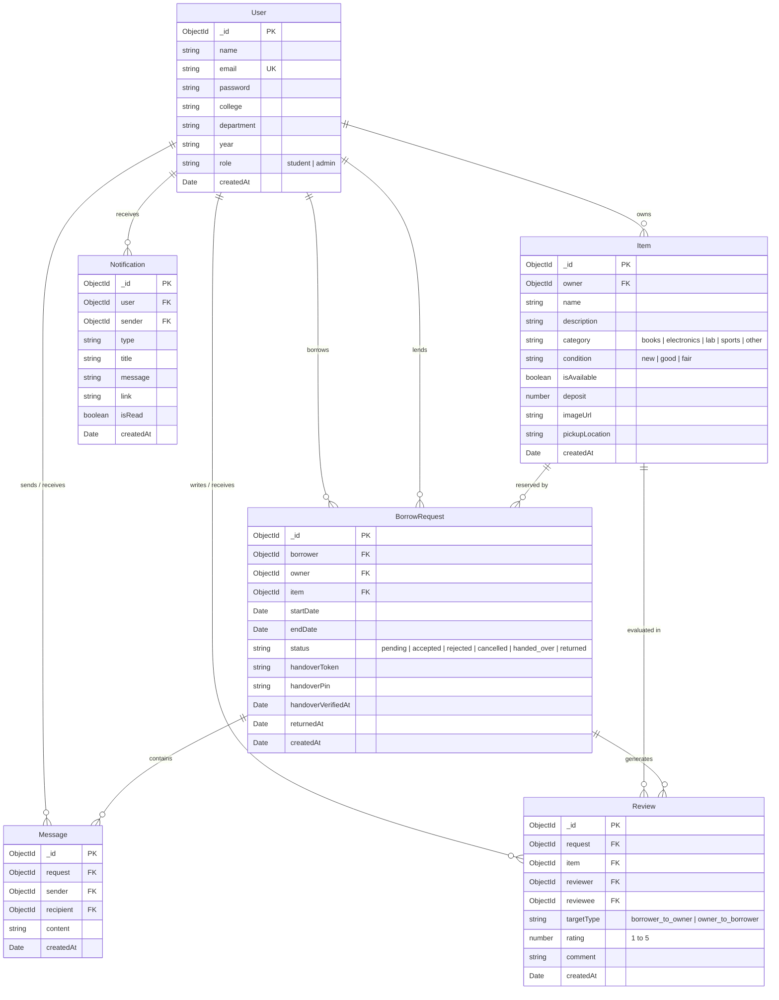

# CampusLoop System Architecture

This document details the software architecture, runtime topology, data flow patterns, and database models of the **CampusLoop** platform.

---

## 1. High-Level Architectural Topology

CampusLoop follows a decoupled Client-Server architecture with a single-page application (SPA) frontend communicating over RESTful HTTP APIs with a Node.js/Express backend, which interfaces with a MongoDB document database.



---

## 2. Directory Structure & Module Breakdown

```
Campus-Loop/
├── client/
│   ├── public/
│   │   ├── favicon.svg
│   │   └── icons.svg
│   ├── src/
│   │   ├── assets/
│   │   │   ├── hero.png
│   │   │   ├── react.svg
│   │   │   └── vite.svg
│   │   ├── components/
│   │   │   ├── Footer.jsx             # Global responsive footer
│   │   │   ├── HandoverModal.jsx      # QR code camera scanner & PIN verification
│   │   │   ├── MessageModal.jsx       # Polling exchange chat dialog
│   │   │   ├── Navbar.jsx             # Floating glassmorphic navigation header
│   │   │   ├── NotificationDropdown.jsx # Real-time notification menu
│   │   │   ├── ReviewModal.jsx        # 5-star rating submission modal
│   │   │   └── ThemeToggle.jsx        # Light/Dark animated toggle switch
│   │   ├── context/
│   │   │   ├── AuthContext.jsx        # User session state & Axios bearer defaults
│   │   │   └── ThemeContext.jsx       # Theme state manager
│   │   ├── lib/
│   │   │   └── utils.js               # clsx and tailwind-merge helper (cn)
│   │   ├── pages/
│   │   │   ├── AdminDashboard.jsx     # Roster and loan telemetry for administrators
│   │   │   ├── BorrowerDashboard.jsx  # Outgoing requests & handover QR code view
│   │   │   ├── CreateListing.jsx      # New resource publication form
│   │   │   ├── Dashboard.jsx          # Live search and category discovery catalog
│   │   │   ├── EditListing.jsx        # Item updating form
│   │   │   ├── ItemDetails.jsx        # Resource specification & booking trigger
│   │   │   ├── Landing.jsx            # Public marketing and value proposition page
│   │   │   ├── Login.jsx              # Student authentication page
│   │   │   ├── OwnerDashboard.jsx     # Owned listings & incoming request management
│   │   │   ├── Profile.jsx            # Student credential and account details
│   │   │   └── Register.jsx           # Student onboarding with institutional email
│   │   ├── App.css
│   │   ├── App.jsx                    # React Router configuration & route guards
│   │   ├── index.css                  # Tailwind styles and custom design system tokens
│   │   └── main.jsx                   # React root hydration
│   ├── package.json
│   ├── tailwind.config.js
│   ├── vercel.json                    # SPA routing rewrite rule
│   └── vite.config.js
├── server/
│   ├── config/
│   │   ├── db.js                      # Mongoose connection & MongoMemoryServer fallback
│   │   └── pickupZones.js             # List of approved campus physical meeting zones
│   ├── controllers/
│   │   ├── adminController.js         # System metrics & administrative queries
│   │   ├── authController.js          # Authentication, domain check & JWT issuance
│   │   ├── itemController.js          # Resource listing CRUD and catalog filtering
│   │   ├── messageController.js       # Transactional peer messaging
│   │   ├── notificationController.js  # User notifications queries and read state
│   │   ├── requestController.js       # Borrowing state machine & handover checks
│   │   └── reviewController.js        # Post-return ratings and user reputation
│   ├── middleware/
│   │   └── auth.js                    # JWT token extraction and role verification
│   ├── models/
│   │   ├── BorrowRequest.js           # Reservation, status transitions, QR/PIN tokens
│   │   ├── Item.js                    # Resource specifications & safe zone validation
│   │   ├── Message.js                 # Scoped chat message schema
│   │   ├── Notification.js            # User event notification schema
│   │   ├── Review.js                  # 5-star ratings with duplicate prevention index
│   │   └── User.js                    # Student accounts with bcrypt hashing
│   ├── routes/
│   │   ├── adminRoutes.js
│   │   ├── authRoutes.js
│   │   ├── itemRoutes.js
│   │   ├── messageRoutes.js
│   │   ├── notificationRoutes.js
│   │   ├── requestRoutes.js
│   │   ├── reviewRoutes.js
│   │   └── uploadRoutes.js
│   ├── utils/
│   │   └── notificationHelper.js      # Internal notification dispatcher
│   ├── package.json
│   ├── seed.js                        # Demo seeder script
│   └── server.js                      # Express application setup and route mounts
```

---

## 3. Core Request Flows

### 3.1 Authentication & Protected API Requests


---

### 3.2 Borrow Request Lifecycle & Safe Handover Verification


---

### 3.3 Safe Pickup Zone Integrity Validation
Physical campus safety is enforced in both application logic and database schema:
1. When creating an item listing (`POST /api/items`), the user must select an authorized location from `SAFE_PICKUP_ZONES`.
2. The `Item.js` Mongoose schema executes a custom schema validator:
   ```javascript
   validate: {
     validator: function(v) {
       return SAFE_PICKUP_ZONES.includes(v);
     },
     message: props => `${props.value} is not an authorized Safe Pickup Zone.`
   }
   ```
3. Current authorized zones include:
   - *Central Library Front Desk*
   - *Student Union Safe Zone*
   - *Makerspace West Wing*
   - *Main Campus Gate Security Desk*
   - *Campus Cafeteria Entrance*
   - *Computer Science Dept Office*
   - *Engineering Hall Floor 2*
   - *Sports Complex Reception*

---

## 4. Database Schema Relationships



---

## 5. Security & Threat Modeling Considerations

1. **Authentication:**
   - Passwords salted with bcrypt (10 rounds).
   - JWT payload contains only non-sensitive identifiers (`id` and `role`).
   - Tokens verified per request in the Authorization header.
2. **Access Control (Authorization):**
   - Resource updates and deletions verify `item.owner.toString() === req.user.id` or `req.user.role === 'admin'`.
   - Message reading and sending verify that the requesting user is either the borrower, the owner, or an administrator.
   - Handover verification requires the resource owner's private credentials.
3. **Data Integrity & Double-Booking Prevention:**
   - Overlap queries check existing reservations for the requested item between `startDate` and `endDate` where status is `accepted` or `handed_over`.
   - Compound index on `Review` (`{ request: 1, reviewer: 1 }`) ensures a participant cannot submit duplicate reviews for the same transaction.
